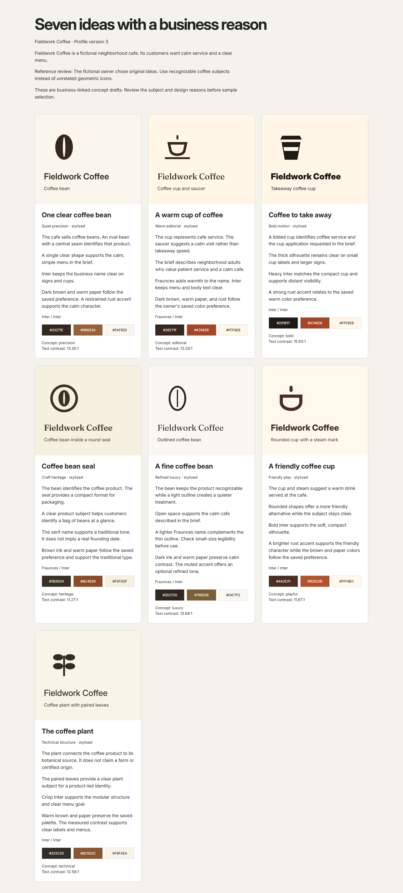

# VIRAX Brand Engine

Set up a business brand through a guided conversation with your AI agent.
The agent asks short questions, saves your answers, and helps you choose a clear visual direction.

**Start with [START-HERE.md](START-HERE.md).**

Tell your agent:

> Set up VIRAX Brand Engine for my business. Read START-HERE.md and ask me the first three questions.

## What you can create

- A private business brief and saved brand rules.
- A design plan that links icon subjects to the business and customers.
- Seven business-linked visual directions for comparison.
- Original SVG symbols and editable logo drafts.
- Separate SVG files with construction guides.
- Font comparisons and a record of font sources.
- A color palette with contrast ratios.
- Black, white, and color versions of the logo.
- A brand guide and reusable design tokens.

SVG means Scalable Vector Graphics.
An SVG file stores shapes that stay sharp at different sizes.
Design tokens are named values for colors, fonts, and spacing.

The project chat is the questionnaire.
The local HTML boards help you compare and review the artwork.
You do not need a second chat interface or an online account for this repo.

## How setup works

1. Answer up to three questions at a time.
2. Review the icon subjects and business reasons before artwork.
3. Compare seven concepts from that plan.
4. Choose or combine the directions.
5. Review one logo sample with its fonts, colors, and construction guides.
6. Approve the exact sample before the agent exports the kit.
7. Review the final files and save the approved brand rules.

References are optional.
You can say, “I do not have references. Give me original ideas.”

## Local tools

The agent can use Node.js 22.16 through 24.x for the local tools.
The repo has no package dependencies.

```sh
git clone https://github.com/vahe-s/virax-brand-engine.git
cd virax-brand-engine
npm ci
npm run engine -- doctor
npm run demo
```

The demo creates a fictional Fieldwork Coffee project in `.data/`.
It does not record a real approval.



Read [docs/commands.md](docs/commands.md) for the agent commands.
Read [docs/questionnaire.md](docs/questionnaire.md) for the interview flow.
Read [docs/design-logic.md](docs/design-logic.md) for the decisions required before artwork.
Read [docs/logo-construction.md](docs/logo-construction.md) for the SVG rules.
Read [docs/brand-kit.md](docs/brand-kit.md) for the delivery checks.

## What the local tools do

The local tools save answers and render geometry from the business design plan.
Deterministic artwork uses fixed rules and produces the same shapes from the same inputs.
The agent supplies the research, design judgment, and custom geometry.
The style catalog supplies font and palette options.
It does not choose an unrelated icon for the business.
The engine requires each concept's subject, business connection, customer reason, and geometric source before artwork.
The agent must inspect whether the artwork and reasons actually fit the brief.

The generator exports editable SVG text.
An outlined wordmark stores each letter as a shape.
The agent must use a vector tool for that separate export.
PNG, PDF, print colors, and custom layouts need suitable tools and a separate inspection.
The repo does not claim name clearance or exclusive rights to starter symbols.

## Private business data

Private projects stay in `.data/`, which Git ignores.
Each business receives its own profile, history, samples, and kit folder.
The public repo contains only engine code, templates, licensed fonts, and fictional examples.

The agent must inspect its actual tools before it promises installation or file access.
A repo link alone does not grant access to your computer or accounts.
No paid service starts by default.

## Fonts and sources

The repo includes Inter and Fraunces for local previews.
Their original SIL Open Font License files remain in `assets/fonts/`.
Their source commits and file hashes appear in `assets/fonts/sources.json`.
The agent can suggest other fonts after it checks your scripts, required weights, and license terms.

See [docs/fonts-and-colors.md](docs/fonts-and-colors.md) for the source links and selection rules.

## Checks

```sh
npm test
npm run check
git diff --check
```

The code uses the MIT License.
The bundled fonts use their own licenses.

Use `node scripts/browser-qa.js` for the optional headless browser checks.
Headless means that the browser runs without a visible window.
Set `VIRAX_CHROME` to a Chromium browser path when automatic detection does not find one.
The check uses a separate temporary browser profile.
It checks asset loads, page width, and vertical mirror geometry for the seven fictional coffee concepts.
The screenshots still need direct visual inspection.
