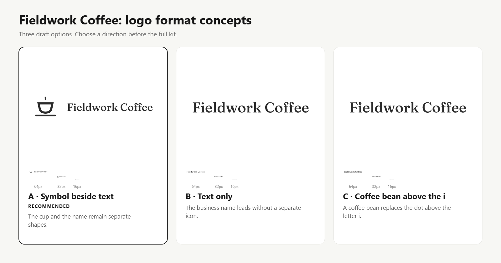

# Logo and text options

Ask which format the owner needs before layout work.
Use the same approved concept across its separate and combined forms.

| Choice | Description | Selection value |
| --- | --- | --- |
| Symbol only | The business symbol without its name | `symbol` |
| Text only | The business name as a wordmark | `wordmark` |
| Horizontal combination | The symbol beside the name | `combined-horizontal` |
| Stacked combination | The symbol above the name | `combined-stacked` |
| Integrated wordmark | A business cue becomes part of a letter | `integrated-wordmark` |

The owner can keep the separate symbol and wordmark even when the primary logo combines them.
The sample board compares the available formats before approval.
The selected `logoMode` controls `primary-logo.svg` and its black and white versions.
An absent mode retains the earlier horizontal default.

## Type and letter geometry

Store optional outlined type in the concept's `wordmarkGeometry` field.
Store custom integrated type in `integratedWordmark`.
Each record contains positive `width` and `height` values and safe geometric `elements`.
Record `wordmarkReason` when either field exists.
The engine rejects an integrated selection without its geometric source.
It does not insert an icon into an arbitrary letter automatically.

The normal generator retains editable text when outlined type is absent.
The agent must flag that draft and complete its outline export before final delivery.
Use the supplied skill for spacing, letter tests, source checks, and layout review.

## Fictional example

The Fieldwork Coffee comparison uses three formats:

- A coffee cup beside the outlined business name.
- The outlined business name without a separate symbol.
- A coffee bean in place of the dot above the letter i.

The custom dot links the name to coffee while the letter stem stays intact.
The plain wordmark serves as the fallback when the bean becomes too small.
Use the separate symbol for very small square placements.
Do not promise readable full text at 16 pixels wide.

Run `node scripts/logo-formats-demo.js` to create the private comparison board.
The demo does not record owner approval or export a final kit.

The example paths come from the bundled Fraunces font at weight 500.
Its original license remains in assets/fonts/fraunces-OFL.txt.
The outline source stays in examples/logo-formats/.

The optional scripts/outline-wordmark.py tool requires Python and fontTools.
It supports Latin text only and does not shape complex scripts.
Inspect its spacing and custom letters before delivery.
Use a suitable font and text tool for Arabic, Indic, and other complex scripts.
